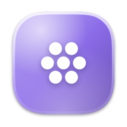
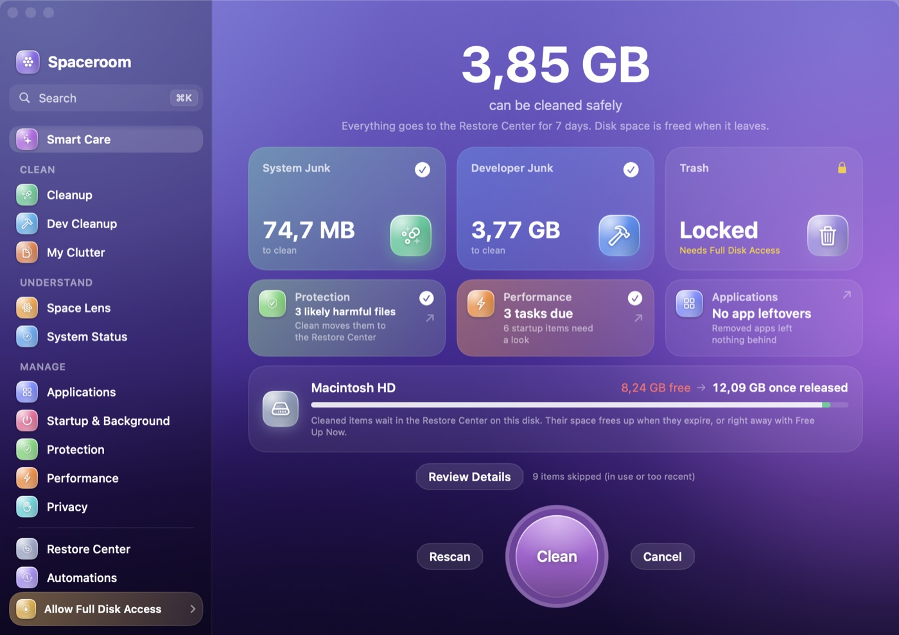

<p align="center">
  
</p>

<h1 align="center">Spaceroom</h1>

<p align="center">
  <strong>Beri Mac Anda ruang lagi.</strong><br>
  Pembersih Mac dan toolkit sistem yang gratis dan open source, dibuat native dengan SwiftUI.<br>
  Semua yang dihapusnya bisa dikembalikan.
</p>

<p align="center">
  <a href="https://github.com/novasilabs/spaceroom-app/releases/latest"></a>
  <a href="https://github.com/novasilabs/spaceroom-app/actions/workflows/ci.yml"></a>
  <a href="LICENSE"></a>
  
</p>

<p align="center">
  <a href="#unduh">Unduh</a> ·
  <a href="#fitur">Fitur</a> ·
  <a href="#cara-spaceroom-menjaga-data-anda">Keamanan</a> ·
  <a href="#build-dari-sumber">Build</a> ·
  <a href="CONTRIBUTING.md">Berkontribusi</a> ·
  <a href="README.md">English</a>
</p>

<p align="center">
  
</p>

> **Status: 0.9 beta.** Semua modul berfungsi dan teruji, tetapi build belum dinotarisasi Apple, dan tugas yang butuh hak admin masih menunggu helper. Lihat [rencana](#rencana).

## Kenapa Spaceroom

- **Lihat semuanya.** Setiap item menunjukkan ukuran, lokasi, dan alasan yang jelas kenapa aman dihapus.
- **Urungkan apa pun.** Item yang dibersihkan masuk ke **Pusat Pemulihan** dan bisa dipulihkan selama 7 hari (bisa diatur 1–30 hari) sebelum dihapus.
- **Angka yang jujur.** Hanya data yang bisa dibuat ulang yang dihitung sebagai sampah. Tanpa angka dibesar-besarkan, tanpa menakut-nakuti.
- **Tidak ada yang keluar dari Mac Anda.** Tanpa akun, tanpa pelacakan, tanpa koneksi jaringan. Semua analisis terjadi di perangkat.
- **Gratis dan terbuka.** GPL-3.0-or-later. Aturan pembersihan berupa JSON biasa yang bisa dibaca dan ditinjau siapa saja.

## Fitur

- **Bersihkan**
  - **Smart Care:** sampah sistem, sampah developer, dan Tong Sampah dalam satu pemindaian, plus tile Perlindungan, Kecepatan, dan Aplikasi.
  - **Pembersihan** dan **Pembersihan Dev:** cache, log, Xcode, simulator, cache package manager, dan folder build (`node_modules`, `target`, `.build`, `.venv`, …) di proyek yang tidak diubah selama 30 hari. Folder yang di-commit ke Git tidak pernah ditawarkan. Tool yang sedang berjalan dilewati.
  - **File Berantakan:** file besar dan lama, duplikat yang dipastikan dari isinya, dan installer yang sudah tidak diperlukan.
- **Pahami**
  - **Space Lens:** peta sunburst interaktif dari folder atau disk mana pun. Centang item lalu pilih *Tinjau dan Hapus*, dan item akan masuk ke Pusat Pemulihan.
  - **Status Sistem:** skor kesehatan; CPU, memori, jaringan, disk, dan baterai secara langsung; dan proses tersibuk.
- **Kelola**
  - **Aplikasi:** hapus instalan sampai bersih, termasuk sisanya.
  - **Startup & Latar Belakang:** audit launch agent dan ringkasan keamanan Mac.
  - **Perlindungan:** temukan file yang menyamar, seperti program berkedok foto atau dokumen, nama menyesatkan, kode tersembunyi di gambar, PDF yang menjalankan skrip, dan aplikasi tidak ditandatangani.
  - **Performa:** tugas perawatan.
  - **Privasi:** jejak browser dan item terbaru, plus tinjauan izin aplikasi. Kata sandi dan bookmark tidak pernah disentuh.
- **Di mana saja**
  - **Pusat Pemulihan** dan bar menu.
  - Palette **⌘K**.
  - **Otomatisasi** terjadwal.
  - **Daftar Abaikan**: klik kanan › *Selalu Abaikan*.
  - Bahasa Inggris dan **Bahasa Indonesia**.

## Cara Spaceroom menjaga data Anda

1. **Aturan berupa data.** Setiap kategori adalah aturan JSON yang menyebut path-nya, alasan aman, dan kapan harus dilewati. Aturan yang tidak valid mematikan pembersihan.
2. **Pagar pengaman di setiap item.** Item harus tetap berada di dalam folder aturannya. Symlink tidak pernah diikuti keluar, dan folder yang dilindungi ditolak.
3. **Dicek ulang sebelum dipindah.** Spaceroom memastikan file-nya masih sama (device dan inode), aplikasinya tidak sedang berjalan, dan item tidak ada di daftar abaikan.
4. **Satu pintu keluar.** Semua modul menghapus lewat Pusat Pemulihan, yang menolak apa pun di daftar abaikan. Kalau daftar abaikan tidak bisa dibaca, tidak ada yang dipindah sama sekali.
5. **Tidak ada keputusan tanpa Anda.** Otomatisasi dan Smart Care hanya memakai aturan yang aman. Data pribadi, cookie, dan item startup tidak pernah dicentang otomatis.
6. **Tanpa admin, tanpa kejutan.** Tugas yang butuh hak admin tetap terkunci sampai helper tersedia.

Detail: [docs/ARCHITECTURE.md](docs/ARCHITECTURE.md) dan [SECURITY.md](SECURITY.md).

## Unduh

1. Ambil **Spaceroom-x.y.z.dmg** dari [Releases](https://github.com/novasilabs/spaceroom-app/releases/latest).
2. Buka, lalu seret **Spaceroom** ke **Aplikasi**.
3. **Pembukaan pertama:** build beta belum dinotarisasi, jadi macOS menahan pembukaan pertama. Buka **Pengaturan Sistem › Privasi & Keamanan**, lalu klik **Tetap Buka** di samping Spaceroom. Cukup sekali.
4. Tur selamat datang akan meminta **Akses Disk Penuh** agar Spaceroom bisa mengukur tempat yang dilindungi, seperti Tong Sampah dan data Safari. Aplikasi tetap berfungsi tanpanya.

Cek keaslian unduhan dengan `shasum -a 256 Spaceroom-x.y.z.dmg`, lalu bandingkan dengan file `.sha256` di halaman rilis.

**Menghapus Spaceroom:** keluar dari aplikasi, hapus aplikasinya, lalu hapus `~/Library/Application Support/Spaceroom`. Ini juga menghapus permanen isi Pusat Pemulihan.

## Build dari sumber

Butuh Xcode 16 atau lebih baru dan [XcodeGen](https://github.com/yonaskolb/XcodeGen).

```bash
git clone https://github.com/novasilabs/spaceroom-app.git
cd spaceroom-app
make bootstrap   # pasang XcodeGen dan buat Spaceroom.xcodeproj
make run         # build Debug, lalu jalankan
make test        # tes engine
make dmg         # build Release jadi dist/Spaceroom-<versi>.dmg
```

## Rencana

- Helper dengan hak admin: cache dan log sistem, flush DNS, Spotlight
- Rilis yang ditandatangani dan dinotarisasi, update otomatis Sparkle, dan Homebrew cask
- CLI `spaceroom`
- Bahasa aplikasi yang tidak dipakai, lampiran Mail, Docker
- Foto yang mirip, tampilan treemap di Space Lens, dan riwayat pertumbuhan storage
- Pembaru aplikasi dan "slim apps"

Rencana lengkap ada di [docs/PRD.md](docs/PRD.md), dan riwayat rilis di [CHANGELOG.md](CHANGELOG.md).

## Berkontribusi

Kontribusi sangat diterima. Aturan pembersihan baru dan terjemahan adalah titik awal yang paling mudah. Baca [CONTRIBUTING.md](CONTRIBUTING.md) dan [Kode Etik](CODE_OF_CONDUCT.md). Masalah keamanan? Laporkan secara privat sesuai [SECURITY.md](SECURITY.md).

## Lisensi

[GPL-3.0-or-later](LICENSE) © Para kontributor Spaceroom. Terinspirasi oleh [Mole](https://github.com/tw93/mole) (lihat [NOTICE](NOTICE)).

Spaceroom adalah proyek independen dan tidak berafiliasi dengan Apple Inc., MacPaw (CleanMyMac), atau proyek Mole.
