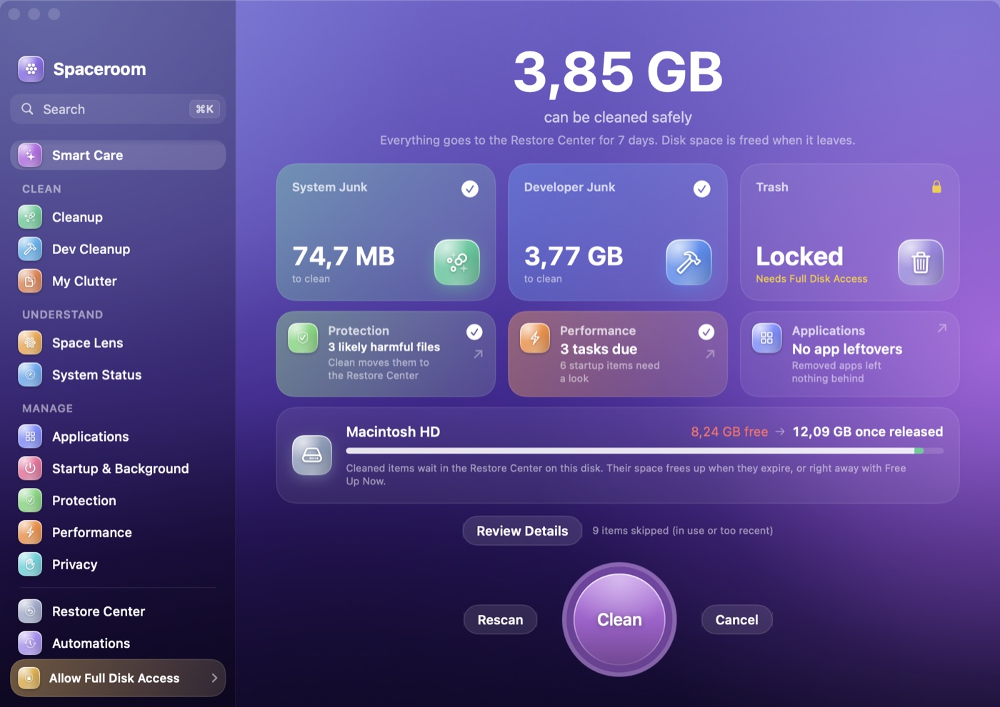
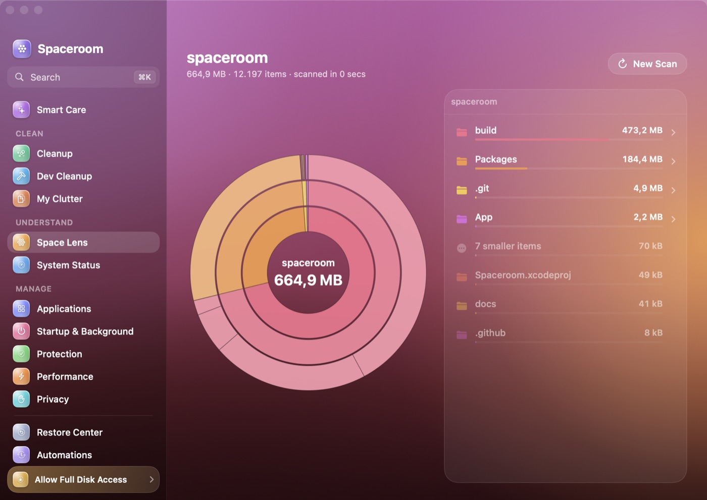
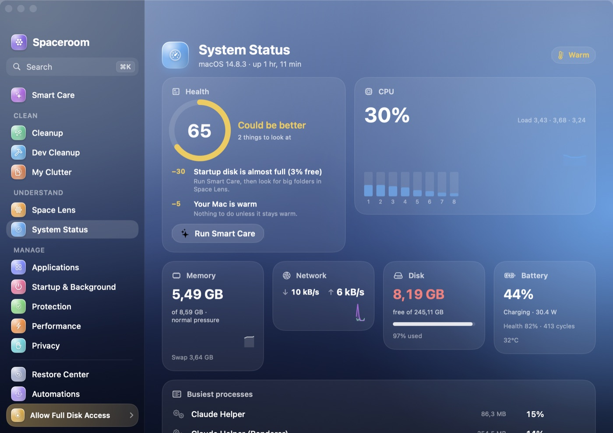
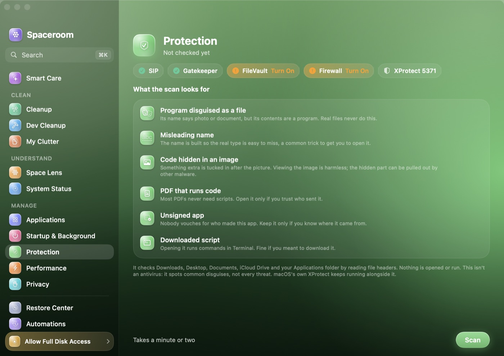
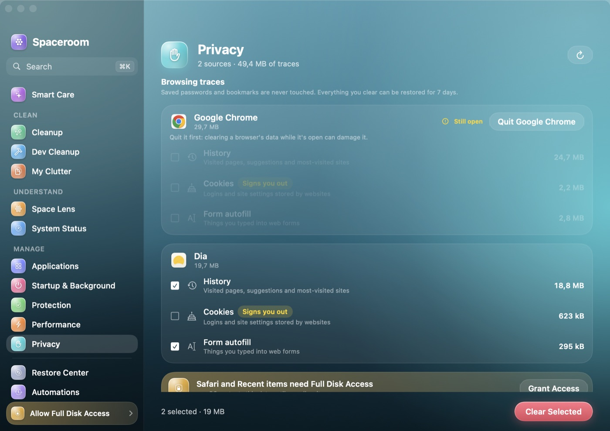
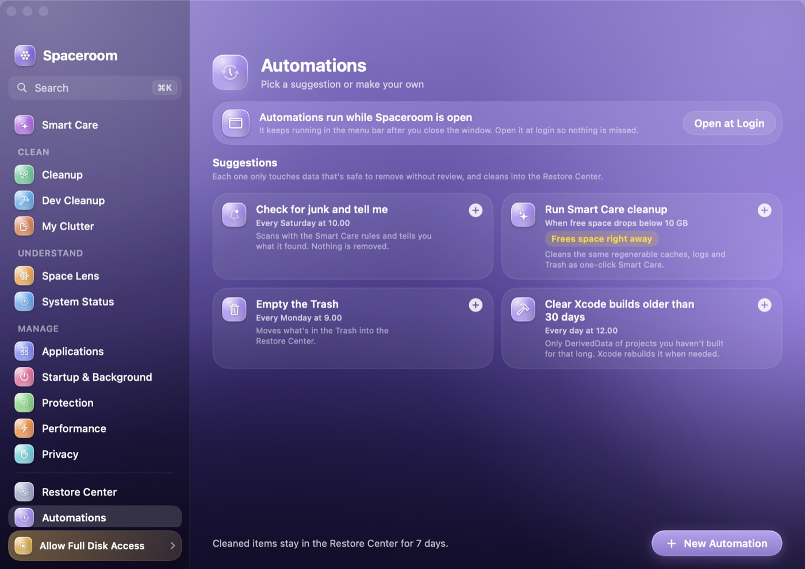
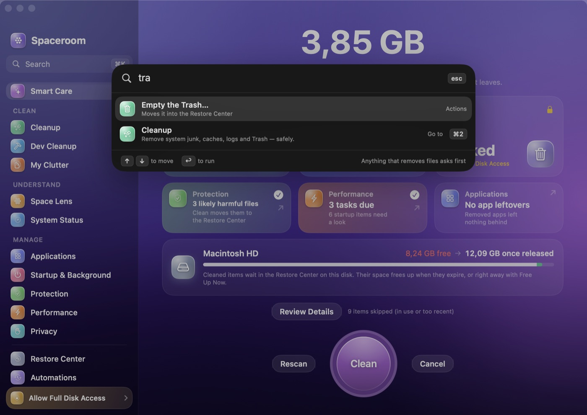
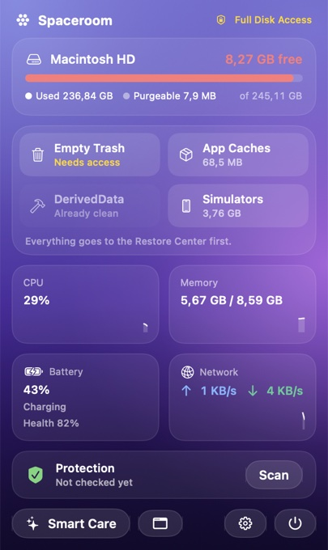

<p align="center">
  
</p>

<h1 align="center">Spaceroom</h1>

<p align="center">
  <strong>Give your Mac room again.</strong><br>
  A free, open-source Mac cleaner and system toolkit, built natively in SwiftUI.<br>
  Everything it removes can be undone.
</p>

<p align="center">
  <a href="https://github.com/novasilabs/spaceroom-app/releases/latest"></a>
  <a href="https://github.com/novasilabs/spaceroom-app/actions/workflows/ci.yml"></a>
  <a href="LICENSE"></a>
  
  
</p>

<p align="center">
  <a href="#download">Download</a> ·
  <a href="#features">Features</a> ·
  <a href="#how-spaceroom-keeps-your-data-safe">Safety</a> ·
  <a href="#build-from-source">Build</a> ·
  <a href="CONTRIBUTING.md">Contribute</a> ·
  <a href="README.id.md">Bahasa Indonesia</a>
</p>

<p align="center">
  
</p>

> **Status: 0.9 beta.** Every module works and is covered by tests, but builds are not notarized yet and admin-only tasks wait for the privileged helper. See the [roadmap](#roadmap).

## Why Spaceroom

- **See everything.** Every item shows its size, its location and a plain-language reason why it's safe to remove.
- **Undo anything.** Cleaned items go to the **Restore Center** and stay restorable for 7 days (1–30, your choice) before they're deleted.
- **Honest numbers.** Only regenerable data counts as junk. Nothing inflated, no scare tactics.
- **Nothing leaves your Mac.** No account, no telemetry, no network requests. All analysis happens on-device.
- **Free and open.** GPL-3.0-or-later. The cleaning rules are plain JSON anyone can read and review.

## Features

### Clean
| | |
|---|---|
| **Smart Care** | One scan for system junk, developer junk and the Trash, plus Protection, Speed and Applications tiles, each with its own toggle. One Undo brings everything back. |
| **Cleanup** | User caches, logs and crash reports, browser caches, the Trash, copies of opened Mail attachments, Photos analysis caches and damaged preference files, all reviewable item by item. Unused app languages are deliberately left alone: removing them breaks the app's signature. |
| **Dev Cleanup** | Xcode DerivedData, iOS DeviceSupport and simulator caches, Homebrew, npm, Yarn, pip, CocoaPods, Go, Cargo and Gradle caches, and build folders (`node_modules`, `target`, `.build`, `.venv`, …) in projects you haven't changed for 30 days. Folders committed to Git are never offered. Skips tools that are running. A separate Docker card frees build cache and untagged images through Docker itself, after a warning that this can't be undone. |
| **My Clutter** | Large and old files, duplicates confirmed by content (one copy is always kept), and installer downloads with their source. |

### Understand
| | |
|---|---|
| **Space Lens** | An interactive sunburst or treemap of any folder or disk that grows while it scans, with drill-in, a breadcrumb and a linked size list. Tick items and choose *Review and Remove*. They go to the Restore Center. |
| **System Status** | A health score with what to fix; live CPU (per core), memory and swap, network, disk, battery health and thermal state; and the busiest processes. |

### Manage
| | |
|---|---|
| **Applications** | Uninstall apps completely, leftovers included (personal data stays unticked), and find what removed apps left behind. |
| **Startup & Background** | Launch agents, daemons and helpers with signature checks and audit findings, plus a security overview (SIP, Gatekeeper, FileVault, Firewall, XProtect). |
| **Protection** | Finds files disguised to trick you: programs named like photos or documents, `invoice.pdf.app` and right-to-left tricks, code hidden after images, PDFs that run JavaScript, unsigned apps and downloaded scripts. It reads headers only and never runs anything. |
| **Performance** | Maintenance tasks with "helps when" notes, last-run times and honest skip reasons. |
| **Privacy** | Clears browser history, cookies, autofill and download history for Safari, Chrome, Dia, Arc, Edge, Brave, Vivaldi and Firefox, and recent-items lists. Never touches passwords or bookmarks. Also reviews which apps hold camera, microphone and other permissions. |

### Everywhere
- **Restore Center:** a timeline of every clean, where you can restore one item, a whole operation or everything, or free the space now.
- **Menu bar:** one item showing the readings you pick, and a popover with storage, quick cleans, CPU, memory, battery, network and Protection status.
- **⌘K command palette:** jump to any screen, run any action or find an app. Anything that removes files measures first and asks.
- **Automations:** "when → do" rules (schedule, low disk, at login, plugged in) that only run Smart Care–safe cleaning.
- **Ignore list:** right-click anything and choose *Always Ignore*. Every scan and the Restore Center honour it.
- **Languages:** English and Bahasa Indonesia.

<table>
  <tr>
    <td></td>
    <td></td>
  </tr>
  <tr>
    <td></td>
    <td></td>
  </tr>
  <tr>
    <td></td>
    <td></td>
  </tr>
</table>

<p align="center"></p>

## How Spaceroom keeps your data safe

Spaceroom deletes files on people's computers, so safety comes before features:

1. **Rules are data.** Every cleaning category is a JSON rule that states its paths, why it's safe and when to skip it. A rule that fails validation disables cleaning (fail-closed).
2. **Guard rails on every item.** Items must stay inside their rule's root folder. Symlinks are never followed out, and protected folders (Documents, Desktop, Library itself, system folders) are refused.
3. **Re-checked before moving.** Right before an item moves, Spaceroom checks that it's the same file it scanned (device and inode), that its app hasn't started, and that it isn't on your ignore list.
4. **One door out.** Every module removes files through the Restore Center, which keeps them restorable and refuses anything on the ignore list. If the ignore list can't be read, nothing moves at all.
5. **Nothing unattended that needs judgement.** Automations and Smart Care only use regenerable, Smart Care–eligible rules. Personal data, cookies and startup items are never ticked for you.
6. **No admin, no surprises.** Tasks that need admin rights stay locked until the privileged helper exists. Nothing is run behind your back.

Details: [docs/ARCHITECTURE.md](docs/ARCHITECTURE.md) and [SECURITY.md](SECURITY.md).

## Download

1. Get **Spaceroom-x.y.z.dmg** from [Releases](https://github.com/novasilabs/spaceroom-app/releases/latest).
2. Open it and drag **Spaceroom** into **Applications**.
3. **First launch:** beta builds aren't notarized yet, so macOS stops the first open. Go to **System Settings › Privacy & Security** and click **Open Anyway** next to Spaceroom. (On macOS 14 you can also right-click the app and choose **Open**.) You only need to do this once.
4. The welcome tour asks for **Full Disk Access**, which lets Spaceroom measure protected places such as the Trash and Safari data. It works without it, and locked places are marked.

Each release includes a `.sha256` file. Check your download with `shasum -a 256 Spaceroom-x.y.z.dmg`.

**Uninstalling Spaceroom:** quit it, delete the app, then delete `~/Library/Application Support/Spaceroom` (this also permanently deletes anything still in the Restore Center).

## Requirements

- macOS 14 Sonoma or later, on Apple Silicon or Intel (universal build)
- About 15 MB of disk space

## Build from source

You need Xcode 16 or later and [XcodeGen](https://github.com/yonaskolb/XcodeGen).

```bash
git clone https://github.com/novasilabs/spaceroom-app.git
cd spaceroom-app
make bootstrap   # installs XcodeGen and generates Spaceroom.xcodeproj
make run         # Debug build, then launch
make test        # engine test suite (Swift Testing)
make dmg         # Release build packaged as dist/Spaceroom-<version>.dmg
```

`make help` lists every task. The `.xcodeproj` is generated from `project.yml` and isn't committed.

## Project layout

```
App/Spaceroom/                 SwiftUI app: modules, design system, menu bar, command palette
  Modules/<Module>/            One folder per sidebar module (model + view)
  Resources/                   Assets and the String Catalog (English, Bahasa Indonesia)
Packages/SpaceroomCore/        The engine, with no UI: rules, scanner, safety guard, Restore Center,
                               ignore list, protection scanner, automations, system monitors
  Sources/SpaceroomCore/Resources/Rules/   Cleaning rules (JSON), the easiest place to contribute
  Tests/SpaceroomCoreTests/    The test suite (sandboxed fake home folders, never your real files)
docs/                          PRD, architecture and screenshots
scripts/make-dmg.sh            Release packaging
project.yml                    XcodeGen project definition
```

## Roadmap

- **Privileged helper:** system caches and logs, plus the admin maintenance tasks (DNS, Spotlight, memory purge)
- **Signed and notarized releases** with Sparkle updates and a Homebrew cask
- **`spaceroom` CLI** (`scan`, `clean`, `status`, `--json`, `--dry-run`) on the same engine
- **My Clutter:** similar photos
- **Space Lens:** storage-growth history
- **Applications:** an app updater and "slim apps" (strip unused architectures)

The full plan is in [docs/PRD.md](docs/PRD.md). See [CHANGELOG.md](CHANGELOG.md) for what's shipped.

## Contributing

Contributions are welcome, and new cleaning rules and translations are the easiest place to start. Read [CONTRIBUTING.md](CONTRIBUTING.md) and our [Code of Conduct](CODE_OF_CONDUCT.md). Found a safety or security problem? Please report it privately, as described in [SECURITY.md](SECURITY.md).

## Acknowledgements

Spaceroom's cleaning categories and several safety heuristics are inspired by [Mole](https://github.com/tw93/mole) by tw93 (GPL-3.0). Rules ported from Mole are marked `"source": "mole"`. See [NOTICE](NOTICE).

## License

[GPL-3.0-or-later](LICENSE) © The Spaceroom contributors.

Spaceroom is an independent project and is not affiliated with Apple Inc., MacPaw (CleanMyMac) or the Mole project. Mac and macOS are trademarks of Apple Inc.
